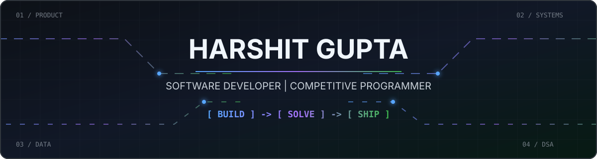

### 18-year-old full-stack developer building reliable systems · Codeforces Expert · 451 problems solved

[LinkedIn](https://www.linkedin.com/in/harshit-gupta--) · [Unstop](https://unstop.com/u/harshgup9009) · [Email](mailto:harshitgupta3.1415@gmail.com) · [LeetCode](https://leetcode.com/u/harshitgupta314/) · [Codeforces](https://codeforces.com/profile/HarshitGupta314)

## About

I am an **18-year-old developer and CTO at [Vedonyx](https://www.vedonyx.com/)**, based in New Delhi, India. I work primarily with TypeScript, Python, React, FastAPI, PostgreSQL, and Flutter. I enjoy taking products beyond the demo stage: defining system boundaries, testing failure cases, documenting trade-offs, and deploying software that other people can evaluate.

**Unstop:** [Top 3% in Unstop Rankings](https://unstop.com/u/harshgup9009) (November 2026).

## Selected engineering work

| Project | Engineering highlights | Stack |
| --- | --- | --- |
| [Backend Fieldguide](https://github.com/harshitgupta31415/backend-fieldguide) · [Live course](https://backend-fieldguide.vercel.app/) | Interactive ecommerce backend course with 108 lessons, 16 practice missions, and browser simulations for inventory and payment retries. | Next.js, React |
| [RollbackReady](https://github.com/harshitgupta31415/nycr3s1-frontend) · [API](https://github.com/harshitgupta31415/nycr3s1-backend) | Evidence-based Prisma migration review with deterministic checks, disposable PostgreSQL simulations, failure timelines, verified recovery plans, CI, containers, and cloud deployment. | Next.js, TypeScript, FastAPI, PostgreSQL, Docker, Kubernetes |
| [Prisma Schema Visualizer](https://github.com/harshitgupta31415/prisma-visualizer) · [Live](https://prisma-visualizer-six.vercel.app) | Interactive ER diagrams with relationship routing, obstacle avoidance, focus states, zoom, pan, and PNG export. | Next.js, React, TypeScript |
| [Memvora CLI](https://github.com/harshitgupta31415/memvora-cli) | Installable CLI for terminal capture, content hashing, offline queueing, workspace configuration, and authenticated synchronization. | Python, Typer, HTTPX |
| [VectorBridge](https://github.com/harshitgupta31415/cdr_to_svg) | Local-first CDR/SVG conversion interface with engine discovery, temporary-file cleanup, progress feedback, and light/dark themes. | TypeScript, Next.js, Node.js |

## Small tools, sharp boundaries

| Tool | What it solves |
| --- | --- |
| [envproof](https://github.com/harshitgupta31415/envproof) | Finds missing, empty, duplicate, and undocumented environment keys without exposing values. |
| [jsonshape](https://github.com/harshitgupta31415/jsonshape) | Detects breaking structural changes between JSON API payloads. |
| [portpick](https://github.com/harshitgupta31415/portpick) | Finds or safely reserves predictable TCP ports for local tools and test suites. |
| [PR Size Guard](https://github.com/harshitgupta31415/pr-size-guard) | Adds configurable pull-request size feedback without tokens or noisy bot comments. |
| [Stack Trace Sprint](https://github.com/harshitgupta31415/stack-trace-sprint) | Turns realistic failure traces into a keyboard-accessible debugging game. |
| [Repo Radar](https://github.com/harshitgupta31415/repo-radar) | Audits repository health and produces actionable local or CI reports. |
| [API Pulse](https://github.com/harshitgupta31415/api-pulse) | Checks endpoint availability, accepted statuses, and latency targets from a small contract. |
| [Contrast Lab](https://github.com/harshitgupta31415/contrast-lab) | Tests accessible colour pairs with exact WCAG calculations and shareable URLs. |

[Browse the complete project index →](PROJECTS.md)

## Open-source contributions

### Merged pull requests [30]

1. [Hindsight: count shared source tokens once per recall](https://github.com/vectorize-io/hindsight/pull/6405) — reported and benchmarked [#6329](https://github.com/vectorize-io/hindsight/issues/6329) and supplied the original [patch](https://github.com/harshitgupta31415/hindsight/commit/929aabdcfa54bd3fd93227a93e64df8132ceb289). The merged fix reuses token counts across observations and skips counting when the budget is unlimited. The maintainer measured **8.42× faster source selection** (6.40 ms → 0.76 ms across 100 observations sharing 100 sources, with a 256-token budget per observation), preserving the selected facts, their order, and the truncation flag.
2. [Hindsight: narrow scoped entity reads before counting mentions](https://github.com/vectorize-io/hindsight/pull/6410) — reported and benchmarked [#6330](https://github.com/vectorize-io/hindsight/issues/6330), credited by the maintainer in the merged PR. The shared visibility query now reads the requested entities' mentions when below a cap, retaining the broad-query fallback. The maintainer's benchmark measured about **10× faster narrow name searches** (585 ms → 58 ms; 300,000 memories, 20,000 entities), with the same rows and counts.
3. [Hindsight: share freshness checks between pages with the same filter](https://github.com/vectorize-io/hindsight/pull/6407) — supplied the report, benchmark and patch idea in [#6325](https://github.com/vectorize-io/hindsight/issues/6325). The merged fix queries each shared filter once while preserving each page's cutoff; the maintainer's benchmark measured **51.64× faster shared-filter freshness checks** (903.7 ms → 17.5 ms; 53 pages, 100,000 memories, PostgreSQL 18 with JIT off).
4. [Hindsight: look up recalled observations by ID](https://github.com/vectorize-io/hindsight/pull/6406) — contributed the patch in [#6324](https://github.com/vectorize-io/hindsight/issues/6324), merged with co-author credit. Reused a dictionary for delete, merge-target and update lookups; the original local benchmark measured up to **6.69× faster Python bookkeeping** (266.21 µs → 39.77 µs; 240 observations, eight deletes and eight updates), excluding database and model calls.
5. [Hindsight: probe for pending consolidation without counting the bank](https://github.com/vectorize-io/hindsight/pull/6403) — contributed the original patch in [#6326](https://github.com/vectorize-io/hindsight/issues/6326), merged with co-author credit. Replaced full-bank counts with an indexed pending-work check; the maintainer's warm-cache benchmark measured about **11.7× faster checks** (≈140 ms → ≈12 ms; one million rows, 100,000 failed facts), excluding consolidation itself.
6. [Hindsight: count shared tag lists once when listing observation scopes](https://github.com/vectorize-io/hindsight/pull/6404) — supplied the original patch in [#6328](https://github.com/vectorize-io/hindsight/issues/6328), merged with co-author credit. Grouped repeated tag lists before sorting and reused the result for the page and total; the maintainer's benchmark measured up to **29.53× faster scope listing** (3.16 s → 107 ms; one million observations, 53 tag sets), with identical output.
7. [Hindsight: batch document-tag reads during scoped retain](https://github.com/vectorize-io/hindsight/pull/6402) — supplied the report, benchmark and original patch in [#6327](https://github.com/vectorize-io/hindsight/issues/6327). Merged upstream with maintainer credit; the original local benchmark measured **35.89× faster tag reads and permission checks** for 3,500 documents (3.04 s → 84.82 ms), excluding extraction and writes.
8. [Hindsight: avoid repeated scans when deleting knowledge folders](https://github.com/vectorize-io/hindsight/pull/6398) — reported and supplied the original patch in [#6323](https://github.com/vectorize-io/hindsight/issues/6323), acknowledged by the maintainer in the merged PR. The merged fix keeps rows on the traversal stack. The original local Python-walk benchmark measured up to **393.39× faster** (10.710 s → 27.22 ms; 25,000 bank nodes, 2,000 folder nodes), excluding database operations.
9. Wonderland: [Browser element picker for Component Preview (#74)](https://github.com/TheWonderlandStudio/Idiot_Box/pull/74), [Commit/Sync main action (#68)](https://github.com/TheWonderlandStudio/Idiot_Box/pull/68), [controls in narrow and short panes (#66)](https://github.com/TheWonderlandStudio/Idiot_Box/pull/66), [file browsing and renaming (#59)](https://github.com/TheWonderlandStudio/Idiot_Box/pull/59), [closed-tab recovery and relative paths (#53)](https://github.com/TheWonderlandStudio/Idiot_Box/pull/53), [log copying and shared-view synchronization (#61)](https://github.com/TheWonderlandStudio/Idiot_Box/pull/61), [recent files and keyboard search (#56)](https://github.com/TheWonderlandStudio/Idiot_Box/pull/56), [workspace bounds and tab dragging (#51)](https://github.com/TheWonderlandStudio/Idiot_Box/pull/51), [startup settings preservation (#50)](https://github.com/TheWonderlandStudio/Idiot_Box/pull/50), [safe replace undo and search positions (#48)](https://github.com/TheWonderlandStudio/Idiot_Box/pull/48).
10. [Babel: speed up MO file writing](https://github.com/python-babel/babel/pull/1376) — used bytearray buffers to avoid repeated string-table copying, with byte-for-byte output and error compatibility checks.

Show 11 more merges (11–21)

11. [tomlkit: speed up array appends](https://github.com/python-poetry/tomlkit/pull/666) — avoided rebuilding the full index on normal array appends, preserving formatting behavior and compatibility fallbacks, with regression coverage.
12. [fsspec: speed up TAR file listing](https://github.com/fsspec/filesystem_spec/pull/2304) — avoided repeated directory-cache scans, with up to **221.795× faster warm TAR listings** in Django-source benchmarks (476.572 ms → 2.149 ms), plus compatibility fallbacks and regression tests.
13. [Babel: speed up PO location lookups](https://github.com/python-babel/babel/pull/1389) — optimized duplicate checks for PO source references while preserving reference order, with regression coverage.
14. [OpenClaw: avoid Doctor backups for unchanged one-shot jobs](https://github.com/openclaw/openclaw/pull/168938) — made cron repair a no-op for canonical schedules while preserving backups for real changes.
15. [OpenClaw: preserve request context in queued operations](https://github.com/openclaw/openclaw/pull/164105) — kept each queued operation's diagnostic context tied to its submitting request, with regression coverage.
16. [OpenClaw: keep distinct mixed-script memories in search results](https://github.com/openclaw/openclaw/pull/164062) — improved Unicode tokenization so distinct Cyrillic, Arabic, and Indic notes are not treated as duplicates.
17. [OpenClaw: find tool parameters inside composed schemas](https://github.com/openclaw/openclaw/pull/164032) — fixed tool discovery for parameter names and descriptions nested in `anyOf`, `oneOf`, and `allOf`, with regression tests.
18. [OpenClaw: seed Discord presence data after startup and reconnect](https://github.com/openclaw/openclaw/pull/141218) — merged with focused regression coverage and runtime-boundary validation.
19. [OpenClaw: clarify replies to buttonless question prompts](https://github.com/openclaw/openclaw/pull/137978) — replaced tap-only guidance with instructions that also work in text-only channels.
20. [OpenClaw: correct node-approval command examples](https://github.com/openclaw/openclaw/pull/153716) — merged documentation fix.
21. [Kubernetes: update the gRPC dependency](https://github.com/kubernetes/kubernetes/pull/141976) — merged upstream contribution.

### Co-authored upstream commits [3 additional]

1. [OpenClaw: localize the Security settings heading](https://github.com/openclaw/openclaw/commit/8618ce35896c66f93523211706ad9ee314273573) — proposed the original fix in [PR #153718](https://github.com/openclaw/openclaw/pull/153718). Maintainers merged replacement [PR #191143](https://github.com/openclaw/openclaw/pull/191143) with co-author credit, making the heading follow language changes while preserving help-text fallbacks.
2. [OpenClaw: handle Windows paths in repository checks](https://github.com/openclaw/openclaw/commit/c9569e415c92416497f25d2352dac69282a852b2) — proposed the original fix in [PR #168956](https://github.com/openclaw/openclaw/pull/168956). Maintainers independently implemented and merged replacement [PR #190069](https://github.com/openclaw/openclaw/pull/190069) with co-author credit, correcting Windows path handling in SQLite and changelog checks.
3. [XlsxWriter: speed up object positioning on uniform-height sheets](https://github.com/jmcnamara/XlsxWriter/commit/a039e83dacf1631d6d19b59f4217c79db8f76160) — reported and benchmarked [issue #1210](https://github.com/jmcnamara/XlsxWriter/issues/1210), then submitted [PR #1211](https://github.com/jmcnamara/XlsxWriter/pull/1211). The maintainer landed a simpler implementation directly on `main` with co-author credit; the PR itself was closed without merging.

## Engineering focus

- **Product engineering:** accessible interfaces, typed APIs, authentication, persistence, and responsive interaction.
- **Backend systems:** Python services, PostgreSQL, migrations, validation, authorization, and failure-safe workflows.
- **Delivery:** automated tests, GitHub Actions, containers, Vercel, Cloud Run, and Kubernetes.
- **Problem solving** · **451 problems solved**, including 392 on LeetCode and 59 on Codeforces. Codeforces Expert with a rating of 1777. [LeetCode](https://leetcode.com/u/harshitgupta314/) · [Codeforces](https://codeforces.com/profile/HarshitGupta314)

## Competitive programming

The Codeforces dashboard is regenerated from the official API every six hours.

## Core toolkit

| Area | Tools |
| --- | --- |
| Languages | TypeScript, Python, JavaScript, Dart, SQL |
| Product | Next.js, React, Node.js, Flutter, FastAPI |
| Data | PostgreSQL, Prisma, SQLAlchemy, Pandas, NumPy |
| Delivery | GitHub Actions, Docker, Kubernetes, Vercel, Google Cloud |

Open to collaborating on developer tools, data products, and reliability-focused web systems.

